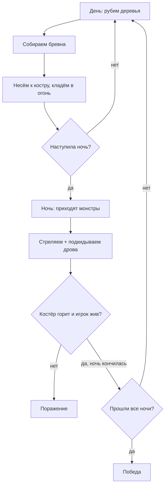

# Tower Defense: Костёр в лесу

2D-игра на Unity (вид сверху) в жанре tower defense, где «башня» — это костёр. Днём игрок рубит деревья и таскает дрова, ночью отбивается от монстров и подкидывает дрова в огонь. Костёр погас — поражение.

> **Статус: в активной разработке.** Сейчас делается MVP (список ниже).

<!-- Сюда вставь GIF или скриншот геймплея:  -->

## Идея

Два режима игры сменяют друг друга и требуют разных действий:

| | День | Ночь |
|---|---|---|
| Длительность | 120 сек | 90 сек |
| Монстры | нет | да |
| Таймер костра | не убывает | убывает |
| Что делает игрок | рубит деревья, собирает бревна, кладёт в костёр | стреляет, подкидывает дрова |

Нужно пережить 3 ночи. Количество монстров растёт: 5, 8, 12.

## Игровой цикл



## Механики

- **Рубка деревьев.** Три размера дерева (1, 2 или 3 бревна). Число ударов до падения выбирается случайно в диапазоне один раз, когда дерево появляется. Между ударами топора есть пауза, чтобы нельзя было зажать кнопку.
- **Инвентарь.** 10 ячеек, из них 2 заняты оружием. Два бревна занимают одну ячейку.
- **Костёр.** Горит по таймеру (максимум 120 сек), каждое бревно добавляет время. Монстры бьют костёр и отнимают время.
- **Оружие.** Топор (только для деревьев) и двустволка: 2 патрона в стволах, перезарядка.
- **Монстры.** Идут к цели и атакуют её. Из убитых с некоторым шансом выпадает аптечка.

## Управление

| Клавиша | Действие |
|---|---|
| WASD | Движение |
| ЛКМ | Удар топором / выстрел |
| 1 / 2 | Выбор оружия (топор / дробовик) |
| E | Подобрать бревно, положить дрова в костёр, подобрать аптечку |
| R | Перезарядка |
| TAB | Инвентарь |

## Архитектурные решения

- **Цель монстра задаётся полем `Transform`**, а не жёстко прописанным игроком. Благодаря этому можно добавлять режимы волн («на костёр» / «на игрока») без переписывания логики монстров.
- **Костёр реализует `IDamageable`.** Для монстра костёр и игрок выглядят одинаково: «урон» костру просто убирает секунды с таймера.
- **Данные в ScriptableObject.** Параметры деревьев (`TreeConfig`) и другие настройки лежат в конфигах, а не в коде.
- **События через SO event channels** (например, `TreeChoppedEventChannelSO`): деревья, инвентарь и UI не знают друг о друге напрямую.
- **Поиск пути монстров развивается по этапам:** прямая линия к цели → A* с обходом деревьев → flow field для толпы.

## Прогресс MVP

- [ ] Игрок ходит, стреляет, рубит
- [ ] Деревья рубятся, дают бревна
- [ ] Инвентарь на 10 ячеек
- [ ] Костёр с таймером и подкидыванием дров
- [ ] Смена дня и ночи
- [ ] Монстры бегут на костёр, бьют его и умирают от пуль
- [ ] Аптечки выпадают из монстров
- [ ] Победа и поражение

## Планы после MVP

- Деревья, которые отрастают заново (три стадии роста)
- A*, затем flow field для толпы монстров
- Процедурная генерация уровня
- Крафт аптечек, голод, охота, рыбалка
- Строительство, компаньон, новые уровни

## Как запустить

1. Установить Unity `[версия, например 6000.x]`.
2. Клонировать репозиторий:
   ```bash
   git clone https://github.com/z21-cloud/TowerDefense.git
   ```
3. Открыть папку проекта в Unity Hub и запустить сцену `[имя сцены]`.

## Технологии

Unity, C#, ScriptableObjects, событийная архитектура.

## Автор

Сергей Старостин — [GitHub](https://github.com/z21-cloud)
